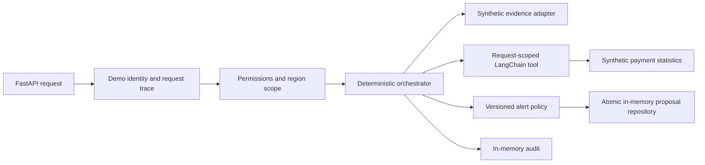

# Architecture

The case study starts from a broad request: answer internal questions, inspect operational data and prepare actions in existing systems. The design separates reasoning from authorization, policy and execution.

## Reference implementation



The browser is a separate static walkthrough, with fixed trace fixtures. It does not call this API. Its architecture view includes target components that are not supplied by the reference implementation.

## Identity and scope

The HTTP adapter creates a new request trace and binds a demo identity to each request. Tenant, subject, permissions and allowed regions are distinct fields. Missing region scope denies access. User-provided headers do not grant authority.

The orchestrator checks read permissions and region scope before retrieving evidence. The payment tool repeats its authorization checks at its own boundary. A shared tool factory never retains a request's identity; each tool closure receives an immutable context.

The demo identity is not authentication. A production adapter must validate a token and trusted claims before constructing the context. Document-level access control also requires a real retrieval adapter; the included adapter returns a synthetic policy excerpt.

## Evidence and policy

Only evidence above the configured relevance threshold reaches the decision. The scores are fixture values, not measured retrieval performance. Missing evidence stops the workflow before the payment adapter is invoked.

Payment statistics must have consistent totals and failure rates. Policy versions must be nonempty and thresholds must be finite values between zero and one. Preparing an alert requires a separate permission when the threshold is reached.

LangChain Core provides the runnable and typed tool contract. There is no model call, semantic routing, MCP transport, network retry policy or live enterprise API in this reference.

## Proposal idempotency

The proposal key derives from tenant, subject, correlation UUID and action type. A separate SHA-256 fingerprint records the normalized request content. Within one process, a lock makes proposal creation atomic:

- identical keys and request fingerprints return the original proposal;
- identical keys with different fingerprints raise a conflict;
- another tenant or subject gets a separate proposal;
- defensive copies prevent caller mutation of stored state.

This is proposal idempotency. Requests below the alert threshold create no proposal, and there is no response cache or external action execution. State is lost when the process stops; multiple workers do not share it. A production adapter needs a unique constraint and atomic conflict handling in shared storage.

## Action lifecycle

`ActionWorkflow` demonstrates the allowed transitions:

```text
proposed → approved → executing → completed | failed
```

It rejects stale versions and invalid transitions and returns a new proposal. It is a pure helper, not a persistence boundary. There are no approval or execution HTTP endpoints. A database-backed implementation must combine version checking and state mutation atomically and bind approval to an authorized actor.

## Audit and tracing

Each HTTP attempt receives its own `trace_id`, also returned in `X-Request-ID`. `correlation_id` belongs to the logical request and remains stable across retries. OpenTelemetry API spans describe the internal decision path, but no SDK exporter is configured.

Completed and rejected requests record in-memory audit events with trace references. Submitted questions are not included in domain error responses or audit metadata. The example does not provide append-only storage, retention management, conversation history or durable audit guarantees.

## Extension points

| Target capability | Required implementation |
| --- | --- |
| Production identity | Validated OIDC tokens, tenant claims and resource scopes |
| Retrieval | Source-level ACL enforcement, provenance and measured relevance |
| Model routing | Untrusted structured outputs checked against allowed capabilities |
| MCP | A transport adapter around explicit tool contracts |
| Durable actions | Database transactions, unique keys, version checks and approval records |
| External effects | Authorized executor, reconciliation and operation-specific retry handling |
| Observability | SDK/exporter setup, redaction, retention and operational monitoring |

These are design directions. The repository does not claim they are already deployed or implemented.
